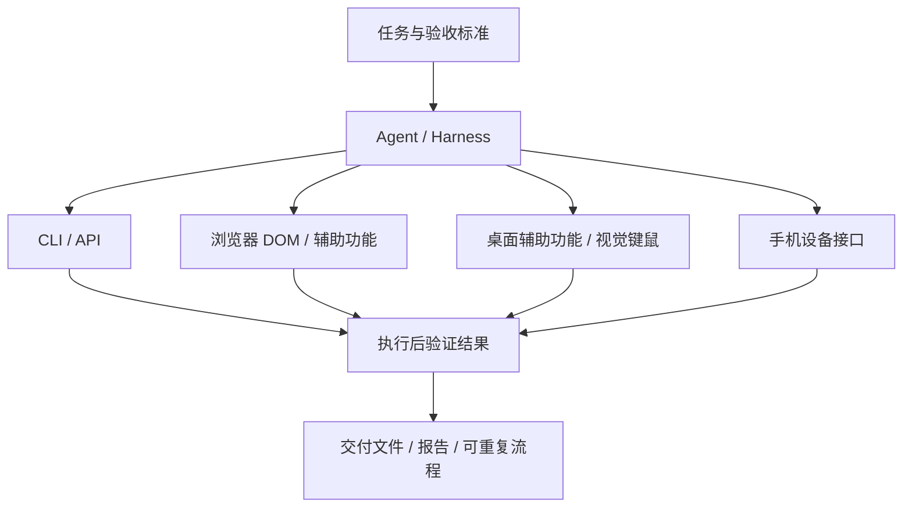

# 按任务选择自动化方案

[返回清单](../README.md) · [官方资料](reading.md)

选择工具前，先确定要操作的对象、是否需要现有登录态，以及结果怎样验证。以下是本清单的选型建议，不是统一性能排名。

## 理解各层的职责



Codex、Claude Code、DSH 等 Harness 管理任务与工具调用；Agent Desktop、Playwright CLI 等工具执行动作；Terminal Mac、E2B 等环境提供可工作的电脑。一个实际方案往往需要组合其中几层。

## 优先选择哪种操作方式

| 条件 | 建议路线 | 典型工具 |
| --- | --- | --- |
| 服务有稳定 API 或 CLI | 使用结构化命令，检查返回值和最终状态 | gh、gws、gog、rclone |
| 文件可直接处理 | 用文件工具完成转换、提取和校验 | Pandoc、MarkItDown、FFmpeg、jq |
| 任务主要发生在网页 | 使用页面结构、元素引用或浏览器 SDK | Ego Lite、Agent Browser、Playwright、Stagehand |
| 任务发生在原生应用且辅助功能信息完整 | 用系统元素与窗口接口 | Agent Desktop、Cua Driver、Peekaboo |
| 控件难以通过结构化接口访问 | 按需要加入截图与视觉定位 | Agent S、UI-TARS、OmniParser |
| 要继续使用自己的电脑 | 选择后台操作能力或独立环境，并核对应用支持 | Ego Lite Space、Terminal Mac、Cua、E2B |
| 已经摸清稳定流程 | 固化为脚本或测试，再接调度与重试 | Playwright、Maestro、Prefect、Windmill |

这些路线可以混合：例如先用 `gh` 下载 Issue 数据，再用浏览器复现问题，最后用脚本生成报告。后台输入能力也不意味着所有对话框和应用都能在后台完成。

## 几种常用组合

### 已登录网站的日常工作

**Codex / Claude Code + Ego Lite**：适合需要已有账号会话、表单操作和人工接管的网站任务。先在 Ego Lite 完成登录，再让 Agent 在任务 Space 中观察和操作。需要复用哪个浏览器的状态应提前说明；不能默认读取任意浏览器中的登录态。[Ego Lite 上游说明](https://github.com/citrolabs/ego-lite)

可以把任务写成：“在指定后台读取本周订单，导出 CSV，按状态汇总，并核对导出行数与页面总数。”让交付物和校验条件成为任务的一部分。

### 原生桌面应用

**Agent + Agent Desktop / Cua Driver / Peekaboo**：先确认目标进程与窗口，读取当前界面，按本次观察得到的元素执行操作，再重新观察结果。Agent Desktop 的元素引用包含快照信息，不能把旧引用当作永久选择器。[Agent Desktop 文档](https://github.com/vercel-labs/agent-desktop)

### 独立虚拟电脑

**Agent + Terminal Mac**：适合 Apple Silicon 上需要独立 macOS 桌面的实验。它控制的是虚拟机内的助手，客体有自己的应用、账号与权限。首轮需要完成 macOS 客体设置；当前上游标记为早期候选版，并说明干净机器上的实时验收仍待完成。[Terminal Mac README](https://github.com/govijr/terminal-mac)

需要 Linux 桌面或云环境，可看 [E2B Desktop](https://github.com/e2b-dev/desktop)；需要组合浏览器、shell 和文件 API，可看 [AIO Sandbox](https://github.com/agent-infra/sandbox)。

### Codex 的三种自动化入口

| 入口 | 适合什么 | 边界 |
| --- | --- | --- |
| [Codex CLI：`codex exec`](https://learn.chatgpt.com/docs/non-interactive-mode) | shell、脚本、流水线、批量任务 | 调度由调用方负责；可用 `--json` 接收 JSONL 事件 |
| [桌面 Computer Use](https://learn.chatgpt.com/docs/computer-use) | 操作已授权的桌面应用 | 取决于支持地区、系统、账户开放情况和应用权限；Windows 使用前台桌面 |
| [定时任务 / Automations](https://learn.chatgpt.com/docs/automations) | 周期性运行已验证的任务 | 本地文件任务需电脑开机、桌面应用运行；Web 任务无法直接使用本地目录 |

CLI 的简单只读起点：

```bash
codex exec "总结此仓库的目录结构，并列出需要进一步核查的问题"
```

这里不把桌面产品能力等同于开源 CLI 仓库的全部能力，也不把某种入口的账号可用性推广到所有入口。

### Claude Code 与 DSH：先分清要桥接什么

| 目标 | 路线 | 实际行为 |
| --- | --- | --- |
| 从 DSH 委派一次任务给原生 Claude Code | [官方 Claude Code Subagent](https://github.com/deepseek-ai/deepseek-harness/tree/master/packages/subagent/subagent-claude-code) | 新的无人值守会话，向父会话返回最终文本或失败诊断 |
| 让 Claude Code 成为 DSH 的模型路线 | [snowan/dsh-claude-plugin](https://github.com/snowan/dsh-claude-plugin) | 社区适配；DSH 继续拥有工具循环，需核对锁定版本 |
| 复用已有技能、配置与约定 | [DSH Bridges](https://github.com/yhlooo/dsh-bridges) | 只迁移文档明确支持的资产，不保证行为完全等价 |
| 在 DSH 上使用 Claude Code 风格的工作方式 | [DSH-CC](https://github.com/dsh-cc/dsh-cc) | 社区插件组合，并非 Claude Code 本体 |

电脑操作是另一层能力：DSH 的官方 [Computer Use](https://github.com/deepseek-ai/deepseek-harness/blob/master/docs/subsystems/computer-use.md) 需要配置一个 provider；原生 CUA 与 Cua Driver 集成仍在实验性范围内。更换模型、桥接 Harness、增加桌面驱动是不同操作。

Claude Code 自身也能直接运行非交互任务：

```bash
claude -p "总结此仓库的 README，并列出缺失的安装说明"
```

参数与 SDK 用法以 [程序化运行文档](https://code.claude.com/docs/en/headless) 为准。

### 从能演示到能重复完成

让一次成功流程具备明确输入、成功条件、失败反馈和可复查结果。评估时记录工具版本、模型、操作系统、任务与耗时；把需要人工接管的步骤单列。重复写入、重试和调度前，确认能够识别已经完成的动作。

对于资料收集或文档处理，通常先把输出固定为 JSON、CSV、Markdown 等文件更容易验收；对于 GUI 任务，应检查保存后的文件或应用中的最终状态，而不只看“点击成功”的返回值。
