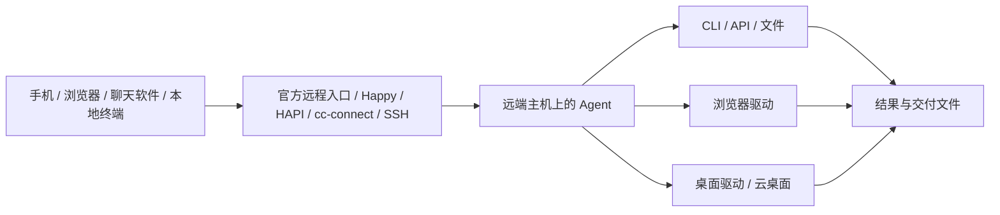

# 远程自动化方案

[返回清单](../README.md#remote) · [选型指南](guide.md) · [官方资料](reading.md)

整理日期：2026-11-06。下面是依据上游文档整理的组合建议，未逐一部署验收。先确定 **Agent 在哪里运行、操作哪台机器、从哪里下达任务**，再选择远程入口。各工具的 Star 数见 [项目清单](../README.md)。

## 按场景选组合

| 想做什么 | 建议组合 | 实际执行位置 | 需要准备什么 |
| --- | --- | --- | --- |
| 出门后用手机继续编码任务 | 官方 Codex Remote / Claude Remote Control；或 Happy / HAPI | 已登录 Agent 的主机 | 主机在线、Agent 会话运行、手机与主机会话配对 |
| 在飞书、钉钉或 Telegram 下达任务 | cc-connect + Codex / Claude Code；或 Hermes / OpenClaw | 部署桥接服务或 Agent 的主机 | 聊天机器人、授权用户、工作目录、模型与工具凭据 |
| 从笔记本控制云服务器上的 Agent | SSH + tmux + Codex / Claude Code / DSH；Mac 可配 cmux | 远端服务器 | SSH 连通、远端安装和登录 Agent、持久会话 |
| 远程操作自己的 Mac 浏览器或 App | 私有网络 + SSH + Ego Lite / Agent Desktop / Peekaboo | 远端 Mac 的用户桌面 | 浏览器登录态、图形会话、工具要求的系统权限 |
| 批量执行网页任务 | Playwright / Puppeteer + Browserless | 远端浏览器服务 | 带鉴权的连接端点、明确的浏览器会话生命周期 |
| 给每个任务一台独立电脑 | Agent + E2B Desktop / Cua；自有 Apple Silicon 主机可研究 Terminal Mac | 云沙箱或虚拟机客体 | 镜像、任务文件、客体账号、输出回收方式 |
| 批量维护远端机器或跑固定流程 | Ansible + SSH；需要调度时接 CI / 工作流服务 | inventory 指定主机或工作节点 | 已验证的脚本、主机身份、可检查的执行结果 |
| 自动化中途需要人接管桌面 | RustDesk / MeshCentral / Apache Guacamole | 被控桌面或远程会话 | 远程桌面服务、账号授权、与 Agent 对齐的会话 |

## 远程入口、执行器和桌面驱动怎样配合



[Tailscale](https://github.com/tailscale/tailscale) 解决主机之间的私有网络连通；[SSH](https://github.com/openssh/openssh-portable) 负责登录和命令通道；Agent 规划任务；Ego Lite、Agent Desktop 等驱动负责界面动作。只装网络工具不会获得电脑操作能力。远端文件、浏览器账号和权限属于远端环境，需要在那里准备。

## 方案一：手机继续主机上的 Agent 会话

| 入口 | 适合谁 | 执行方式与边界 |
| --- | --- | --- |
| [Codex Remote Connections](https://learn.chatgpt.com/docs/remote-connections) | 使用官方桌面与手机产品 | 手机连接同账号 / 工作区的主机；主机需保持在线和唤醒，任务使用主机上的项目、工具与权限。具体入口取决于账户和平台开放情况 |
| [Claude Code Remote Control](https://code.claude.com/docs/en/remote-control) | 已在本机使用 Claude Code | 在已信任项目运行 `claude remote-control`，按终端提示打开链接或扫码；执行仍在原主机。需符合条件的 claude.ai 登录，API Key 不能直接替代 |
| [Happy](https://github.com/slopus/happy) | 希望用手机 / Web 控制 Claude Code 或 Codex | 在执行主机启动 Happy CLI，手机配对查看会话、结果与审批；上游说明采用端到端加密 |
| [HAPI](https://github.com/tiann/hapi) | 希望自托管入口，接入多种 CLI Agent | Hub + CLI + Web / PWA / 原生 App；支持加密 relay。Web / PWA 与原生客户端的收费边界见上游 |

Claude Code 已有会话也可使用 `/remote-control`。远程入口需要对应主机进程保持运行；它不会自动把任务搬到云服务器。首次启用、会话配对及权限范围按官方提示处理。

Happy 的当前 CLI 示例是 `happy claude` / `happy codex`；HAPI 的 relay 示例是 `npx @twsxtd/hapi hub --relay`，随后另开终端运行 `npx @twsxtd/hapi`。先按各自 README 安装、登录底层 Agent，再连接手机端。[Happy 用法](https://github.com/slopus/happy) · [HAPI 用法](https://github.com/tiann/hapi)

## 方案二：聊天软件作为任务入口

**[cc-connect](https://github.com/chenhg5/cc-connect) + 已有 CLI Agent** 适合把飞书、钉钉、Telegram 等聊天渠道接到现有工作目录。安装在实际执行任务的主机上，配置渠道和允许访问的用户，再选择对应 Agent。不同渠道的连接方式不同，很多支持无需公网入站的方式；是否需要 Webhook 以该渠道文档为准。

**[Hermes Agent](https://github.com/NousResearch/hermes-agent) / [OpenClaw](https://github.com/openclaw/openclaw) / [nanobot](https://github.com/HKUDS/nanobot)** 适合把消息入口、技能、记忆和周期任务放进长期运行的个人助手。Hermes 还提供 SSH、Docker、Modal、Daytona、Vercel Sandbox 等终端后端；这描述的是终端执行位置，桌面操作仍需另外接驱动。

典型流程：聊天消息 → 执行主机上的 Agent → 调用工具 → 生成报告或文件 → 原渠道返回结果。对外发送、删除和发布等动作的审批策略，应在所用 Agent 和渠道中配置；聊天群成员不应自动等同于主机授权用户。

## 方案三：SSH + tmux，让任务留在远端主机

适合已有 Linux / macOS 服务器、需要终端交互和持续会话的情况。下面假设 `automation-host` 是自己配置好的 SSH 别名，项目和 Agent 已在远端准备好：

```bash
ssh automation-host
tmux new-session -A -s agent-work
cd ~/work/project
codex
```

需要 Claude Code 或 DSH 时，将最后一行替换为相应命令。在 tmux 内按 `Ctrl-b`，再按 `d` 可以分离会话；重新 SSH 后用同一条 `tmux new-session -A -s agent-work` 恢复。[tmux](https://github.com/tmux/tmux) 能保留连接断开后的终端会话，但主机关机、进程退出和未处理的审批仍会影响任务。

Mac 上的 [cmux](https://github.com/manaflow-ai/cmux) 提供 `cmux ssh user@remote` 工作区，可统一观察远端终端、浏览器与通知。官方 Codex 桌面也提供 SSH 项目连接：先验证 SSH 配置，确保远端 Codex 已安装、认证且在登录 shell 的 PATH 中，再通过 Connections 添加远端项目。[Codex SSH 连接文档](https://learn.chatgpt.com/docs/remote-connections)

固定的批处理可以使用 Agent 的非交互模式并保存日志和返回码；需要重复执行、重试和产物归档时，再接工作流或 CI。交互会话常驻与任务调度是两个独立需求。

## 方案四：从其他设备操作远端 Mac 的浏览器和 App

**Tailscale / 已有私有网络 + SSH + [Ego Lite](https://github.com/citrolabs/ego-lite) / [Agent Desktop](https://github.com/vercel-labs/agent-desktop) / [Peekaboo](https://github.com/openclaw/Peekaboo)** 是一种可组合的路线：

1. 在被控 Mac 的用户会话中安装和启动浏览器 / 桌面工具，完成需要的登录和系统权限。
2. 让 Agent 在该主机运行，或通过 SSH 调用该主机的 CLI。先读取工具当前 Skill / 帮助，并检查能否观察到目标窗口。
3. 用本次读取到的页面元素或辅助功能元素执行动作，保存结果，再从文件或应用状态验证完成情况。
4. 需要人工处理验证码、登录或模态窗口时，通过远程桌面接管同一会话，处理后再继续 Agent。

Ego Lite 适合已登录网站与任务 Space；Agent Desktop / Peekaboo 面向原生 App。SSH 服务能够运行 shell，不代表自动具备可用的图形桌面和辅助功能权限。Windows 的电脑操作也需要明确使用哪个交互式用户会话；无头服务器应选择专门的浏览器或虚拟桌面环境。

这是按工具职责组合出的方案，能否完整远程运行取决于目标系统版本、图形会话状态和所选驱动。不要把本机浏览器登录态与远端浏览器登录态混为一谈。

## 方案五：云浏览器与云桌面

| 组合 | 适用任务 | 关键区别 |
| --- | --- | --- |
| Playwright / Puppeteer + [Browserless](https://github.com/browserless/browserless) | 批量网页流程、截图、浏览器测试 | 客户端连接远端浏览器端点；会话持久化、下载和登录状态需要按部署方式配置。自托管和商业使用条款见上游 |
| Agent + [E2B Desktop](https://github.com/e2b-dev/desktop) | 独立 Linux 图形桌面的操作任务 | 桌面、文件和账号位于沙箱，任务结束前回收交付物 |
| Agent + [Cua](https://github.com/trycua/cua) | 组合电脑驱动与虚拟 / 托管环境 | 按使用的 Driver、Lume、Spaces 等组件选择部署方式和许可 |
| Agent + [AIO Sandbox](https://github.com/agent-infra/sandbox) | 同时需要浏览器、shell、文件与服务 API | 一套隔离环境提供多类工具，需自行接入任务规划和验收 |
| 远程 Apple Silicon 主机 + [Terminal Mac](https://github.com/govijr/terminal-mac) | 独立 macOS 客体中的自动化实验 | 使用自己的 Mac 主机运行虚拟机；客体首次设置、应用安装与登录需单独完成，当前仍属早期项目 |

云浏览器适合网页任务，云桌面适合需要原生应用或完整桌面的任务。它们通常使用独立环境；需要个人网站账号时，应明确采用哪种登录和会话保存机制。

## 方案六：批量主机与持续工作流

**[Ansible](https://github.com/ansible/ansible) + SSH** 适合多台机器的配置、部署和已明确步骤的运维任务。Agent 可以协助编写和审阅 playbook，但实际主机变更由 inventory、playbook 和执行权限决定。对同一批机器重复运行时，应检查任务是否能识别已完成的状态。

仓库任务可看 [Codex GitHub Action](https://github.com/openai/codex-action) 与 [GitHub Agentic Workflows](https://github.com/github/gh-aw)；跨服务流程可看 [n8n](https://github.com/n8n-io/n8n)、[Windmill](https://github.com/windmill-labs/windmill) 和 [Prefect](https://github.com/PrefectHQ/prefect)。这些工具提供工作流或调度入口，桌面任务仍需连接实际可用的浏览器 / 桌面执行环境。

## 网络入口与人工接管如何选

| 工具 | 主要作用 | 与自动化的关系 |
| --- | --- | --- |
| [Tailscale](https://github.com/tailscale/tailscale) | 私有网络和设备连通 | 让 SSH、浏览器或管理服务在授权设备之间可达 |
| [frp](https://github.com/fatedier/frp) | NAT 后服务的反向代理 | 适合已有公网中转的部署；服务自身仍需要鉴权和访问控制 |
| [RustDesk](https://github.com/rustdesk/rustdesk) | 远程桌面和人工控制 | 人工登录、处理意外界面、观察执行过程；可以按上游方案自托管服务 |
| [MeshCentral](https://github.com/Ylianst/MeshCentral) | 自托管设备管理、桌面、终端与文件 | 多设备管理与人工接管入口 |
| [Apache Guacamole](https://github.com/apache/guacamole-server) | 浏览器访问 RDP / VNC / SSH | 需要同时部署服务端和 [Web 客户端](https://github.com/apache/guacamole-client)；访问的桌面会话应与 Agent 操作目标一致 |

SSH、CDP / 浏览器调试端点和 Agent 控制端点均应放在经过鉴权的访问路径中。隧道提供连通性，不能替代目标服务的身份校验。选择远程桌面工具时，也要确认连接的是当前桌面还是另一个新会话，避免人在一个窗口处理、Agent 却在另一会话等待。
